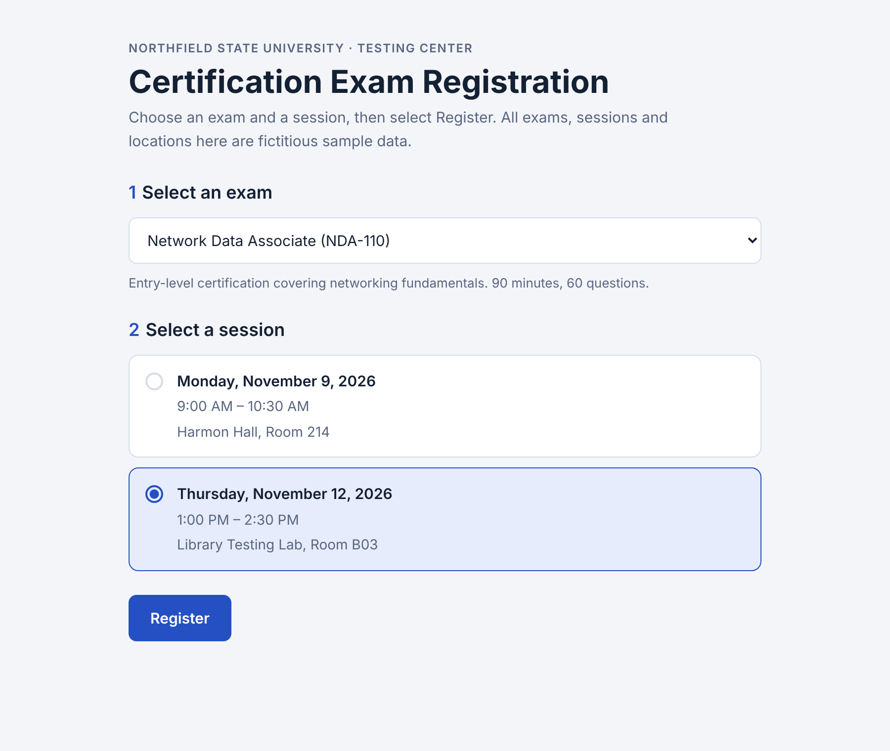
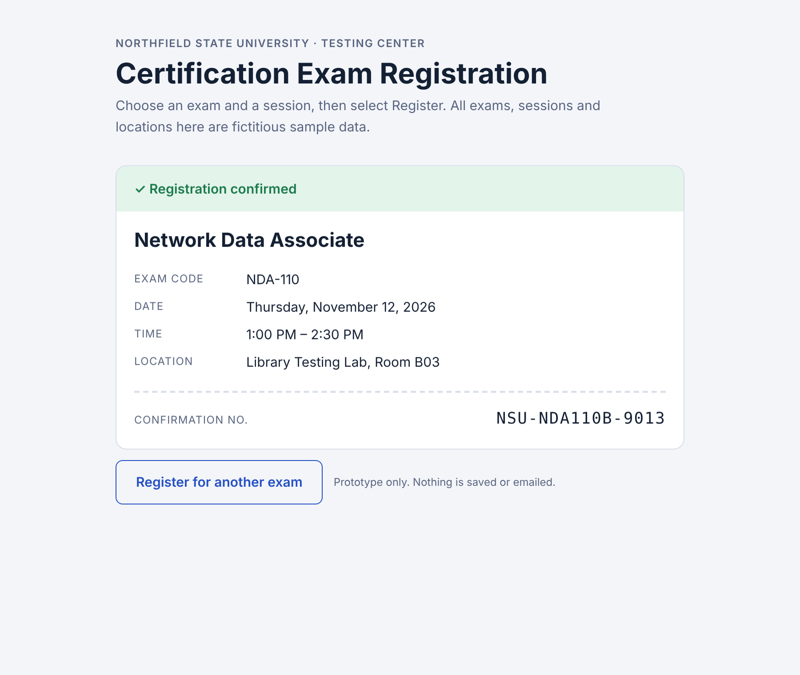

# CSN Certification Exam Registration System

A self-service web app for students to register for proctored IT certification exams (Microsoft, Cisco, CompTIA and others) across three college campuses, with a faculty portal for scheduling sessions, managing the approved exam list and running reports.

I designed this system in CIT 260 at the College of Southern Nevada, starting with a preliminary analysis, then requirements and a data design, then a working prototype. I'm now building it into a full application.

> **Student portfolio project.** Not affiliated with or endorsed by the College of Southern Nevada. All people, exams and sessions in this repo are fictitious sample data.

**Live prototype:** https://csn-exam-registration-prototype-jalug3ihc.vercel.app/



## The problem

Exam sign-ups were handled with manual lists and spreadsheets shared by email. That leads to double-booked rooms, wrong seat counts, duplicate sign-ups and misspelled data. The system replaces that with drop-down-only registration and three rules the system enforces automatically:

1. **No double-booked rooms.** Two sessions can't be scheduled in the same room at overlapping times.
2. **No duplicate registrations.** A student can hold only one active registration per exam.
3. **No registration once full.** A full session disappears from the student's choices (no waitlist).

## Project status

| Stage | Status | Where |
|---|---|---|
| Preliminary analysis (scope, cost, feasibility) | Done | [docs/preliminary-analysis.md](docs/preliminary-analysis.md) |
| Requirements (31, each with a test script) | Done | [docs/requirements.md](docs/requirements.md) |
| Data design (10 tables, 3NF, ERD) | Done | [docs/data-design.md](docs/data-design.md) |
| Course prototype (select exam → register → confirmation) | Done | [prototype/](prototype/) |
| PostgreSQL schema with business rules enforced and tested | Done | [db/](db/) |
| Full web application | In progress | See [roadmap](#roadmap) |

## Prototype

The course's final deliverable was a single registration flow: pick an exam and a session, click **Register**, and see a confirmation that matches the selections. It's one self-contained HTML file with no dependencies.

**Run it:** download [`prototype/index.html`](prototype/index.html) and open it in any browser.



## Database

[`db/schema.sql`](db/schema.sql) implements the data design in PostgreSQL. The business rules live in the database, so they hold no matter what the application code does:

| Rule | Enforced by | Requirement |
|---|---|---|
| No double-booked rooms | `EXCLUDE USING gist` constraint on room + time range | REQ01 |
| One active registration per exam | Partial unique index on `(student_id, exam_id) WHERE status = 'Active'` | REQ23 |
| No registration once full | Trigger that locks the session row and checks seats, so two students can't take the last seat at once | REQ02 |
| A registration must match an exam the session offers | Composite foreign key to `session_exam` | Data design |

[`db/test_rules.sql`](db/test_rules.sql) runs the requirement test scripts against the database: overlapping sessions, duplicate registrations, filling and overfilling a session, cancelling to free a seat (REQ22) and the end-of-semester wipe (REQ25).

**Run it** (PostgreSQL 14+):

```bash
createdb exam_registration
psql -d exam_registration -f db/schema.sql
psql -d exam_registration -f db/seed.sql
psql -d exam_registration -f db/test_rules.sql   # expected rejections print as ERROR lines
```

## Roadmap

Built in slices, each mapped to the requirements it delivers.

- [x] Course prototype: select → register → confirm
- [x] Database schema with the three business rules (REQ01, REQ02, REQ23)
- [ ] Deploy the app shell to Vercel
- [ ] Student registration screen on live data: campus → date → time → exam drop-downs (REQ08–REQ14, REQ26)
- [ ] Sign-in and separate student and faculty access (REQ05–REQ07)
- [ ] Registration history and self-cancellation up to 5 minutes before the exam (REQ21, REQ22, REQ24)
- [ ] Faculty portal: sessions, proctors, campuses, approved exams, student and staff file upload (REQ16, REQ17, REQ19, REQ27, REQ28, REQ30, REQ31)
- [ ] Confirmation emails from a faculty-editable template (REQ03, REQ15)
- [ ] Reports with CSV, Excel and PDF export (REQ04, REQ18, REQ29)
- [ ] End-of-semester data wipe, shown on the demo as "Reset demo data" (REQ25)

## Tech stack

| Layer | Choice |
|---|---|
| Front end and API | Next.js (React with API routes) |
| Database | PostgreSQL on Supabase |
| Hosting | Vercel |
| Email | Resend |
| Development | AI-assisted with Anthropic Claude |

## Repository layout

```
docs/        Preliminary analysis, requirements, data design, screenshots
prototype/   Course prototype (single HTML file)
db/          PostgreSQL schema, sample data and rule tests
```
