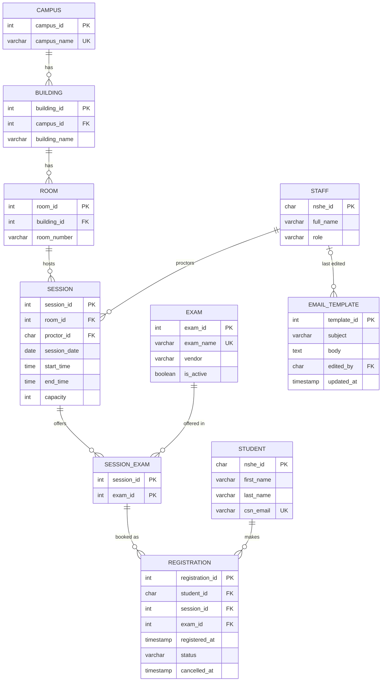

# Data Design

The registration system stores its data in a PostgreSQL database with 10 tables, normalized to third normal form (3NF). The tables cover students, staff, campus locations, the approved exams, exam sessions, registrations, and the confirmation email template.

The design supports every requirement in [requirements.md](requirements.md) (REQ01–REQ31), including the three core business rules: no double-booked rooms, no duplicate registrations for the same exam, and no registration once a session is full (no waitlist).

The working schema is in [`db/schema.sql`](../db/schema.sql).

## Entity relationship diagram

Each registration ties one student to one exam at one session. `Session_Exam` links each session to the exams it offers, and every registration points to one row of it.

## Data dictionary

| Table | Field | Data type | Key | Description |
|---|---|---|---|---|
| Student | nshe_id | CHAR(10) | PK | 10 digits, numbers only, and unique. Password for REQ06 |
| Student | first_name | VARCHAR(50) |  | Required (loaded from student file) |
| Student | last_name | VARCHAR(50) |  | Required (loaded from student file) |
| Student | csn_email | VARCHAR(100) | UK | Required and unique. Used as login username for REQ06 |
| Staff | nshe_id | CHAR(10) | PK | 10 digits, numbers only, and unique |
| Staff | full_name | VARCHAR(100) |  | Required (loaded from the instructor/proctor file) |
| Staff | role | VARCHAR(20) |  | Instructor/Proctor/Faculty |
| Campus | campus_id | INT | PK | auto-generated |
| Campus | campus_name | VARCHAR(50) | UK | West Charleston, North Las Vegas, or Henderson for REQ19 |
| Building | building_id | INT | PK | auto-generated |
| Building | campus_id | INT | FK | Links to campus |
| Building | building_name | VARCHAR(50) |  | required |
| Room | room_id | INT | PK | auto-generated |
| Room | building_id | INT | FK | Links to building |
| Room | room_number | VARCHAR(10) |  | Required and unique within a building |
| Exam | exam_id | INT | PK | auto-generated |
| Exam | exam_name | VARCHAR(100) | UK | Required and unique (Microsoft Associate, etc) |
| Exam | vendor | VARCHAR(50) |  | Certifying company (Microsoft, Cisco, etc) |
| Exam | is_active | BOOLEAN |  | True = on the terms approved list REQ17 |
| Session | session_id | INT | PK | auto-generated |
| Session | room_id | INT | FK | Links to room. No overlapping times in the same room for REQ01 |
| Session | proctor_id | CHAR(10) | FK | Links to staff. Dropdown chosen for REQ16 |
| Session | session_date | DATE |  | Required |
| Session | start_time | TIME |  | Required |
| Session | end_time | TIME |  | Required. Must be after the start_time |
| Session | capacity | INT |  | Default set to 20. Faculty can change number for REQ30-31, must be greater than 0 |
| Session_Exam | session_id | INT | PK,FK | Links to session |
| Session_Exam | exam_id | INT | PK,FK | Links to exam |
| Registration | registration_id | INT | PK | auto-generated |
| Registration | student_id | CHAR(10) | FK | Links to student |
| Registration | session_id | INT | FK | Links to Session_Exam, together with exam_id |
| Registration | exam_id | INT | FK | One active registration per student per exam for REQ23 |
| Registration | registered_at | TIMESTAMP |  | Set automatically on submit |
| Registration | status | VARCHAR(10) |  | Active or cancelled. Cancelling frees the seat for REQ22 |
| Registration | cancelled_at | TIMESTAMP |  | Blank unless cancelled. Allowed up to 5 minutes before start for REQ24 |
| Email_Template | template_id | INT | PK | auto-generated |
| Email_Template | subject | VARCHAR(150) |  | required |
| Email_Template | body | TEXT |  | Placeholder filled per student: name exam, campus, building, room, date, start time, end time for REQ15 |
| Email_Template | edited_by | CHAR(10) | FK | Links to staff. Faculty member last to edit |
| Email_Template | updated_at | TIMESTAMP |  | Set automatically when saved |

## Business rules

| Rule | How the database enforces it | Requirement |
|---|---|---|
| No double-booked rooms | No two sessions with the same `room_id` can have overlapping start/end times (exclusion constraint) | REQ01 |
| No duplicate registrations | Only one active registration per `student_id` and `exam_id` (partial unique index) | REQ23 |
| No registration once full | A registration is rejected when active registrations for a session equal its capacity (trigger with a row lock) | REQ02 |

## What is not stored

Reports (REQ18, REQ29) are generated from these tables when they are run. Scores, payments and attendance are out of scope (REQ20). There is no term table, because all data is deleted at the end of each semester (REQ25).
